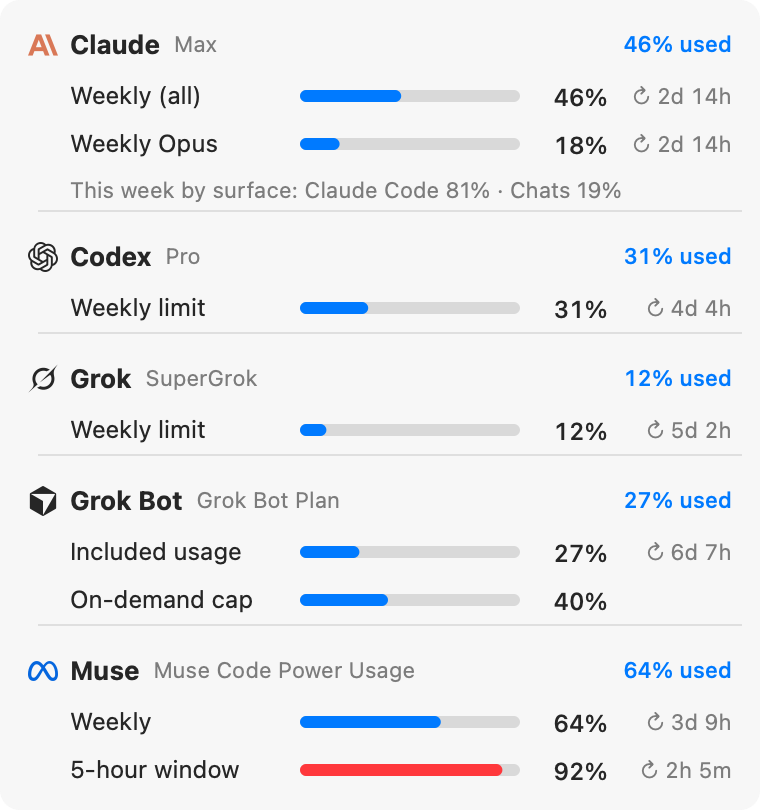

# Leeway

A macOS menu bar app that shows how much of your weekly allowance you have used on
each AI coding tool signed in on your Mac.

<picture>
  <source media="(prefers-color-scheme: dark)" srcset="docs/preview-dark.png">
  
</picture>

Illustrative figures.

It reads what those tools already keep on your Mac and asks each vendor's own usage
endpoint. No account, no server, no telemetry, and read-only by default. It's one
Swift file you can read in a sitting.

| Provider | Needs | What you see |
|---|---|---|
| Claude | Claude Code signed in | Weekly limits, 5-hour window, share by surface |
| Codex | Codex CLI signed in with ChatGPT | Weekly limit, plan, credits, limit resets |
| Gemini | Gemini CLI signed in | Per-model quota |
| Grok Build | `grok` CLI signed in | Weekly limit, plan, pay-as-you-go |
| Grok Bot | Grok Bot desktop app | Included usage, on-demand spend against cap |
| Muse Code | `muse` CLI signed in | Weekly and 5-hour windows |

Tools you don't have are left out. On first launch a Setup Check window lists what
was found and how to set up the rest.

## Install

Needs macOS 13 or later, on Apple Silicon or Intel.

1. Download the `.dmg` from the [latest release](https://github.com/d0s1nt/leeway/releases/latest).
2. Open it and drag **Leeway** to **Applications**.
3. Open Leeway from Applications. macOS will say it can't check the app, because
   releases aren't yet notarized by Apple. Click **Done**, then go to
   **System Settings › Privacy & Security**, scroll down and click **Open Anyway**
   next to Leeway. This is needed once.
4. macOS asks whether **security** may use "Claude Code-credentials" from your
   keychain. That's Leeway reading Claude Code's sign-in, so choose **Always Allow**
   (or Allow, to be asked again next time).
5. Optional: in the dropdown, choose **Settings › Launch at Login**.

**With Homebrew** instead of steps 1 and 2:

    brew tap d0s1nt/leeway https://github.com/d0s1nt/leeway
    brew trust d0s1nt/leeway
    brew install --cask d0s1nt/leeway/leeway

`brew upgrade` then keeps it current. Homebrew asks you to trust the tap because it
isn't one of Homebrew's own. It doesn't get around step 3: macOS still asks for
**Open Anyway** on first launch, and may again after an upgrade, until releases are
notarized. Upgrading quits Leeway; open it again from Applications.

Verify a download

Releases are built by GitHub Actions from the tagged commit, with a signed build
provenance attestation. With the GitHub CLI:

    gh attestation verify Leeway-1.2.0.dmg --repo d0s1nt/leeway

`SHA256SUMS.txt` on each release lists the checksums.

Build from source

Needs the Xcode command line tools (`xcode-select --install`).

    git clone https://github.com/d0s1nt/leeway.git && cd leeway
    ./build.sh

That compiles a universal app to `~/Applications/Leeway.app` and launches it.

## Using it

The menu bar shows a small bar chart with one bar per tool, in the same order and
filled the same way as the dropdown's bars, turning orange then red near a limit.
Next to it is the tool to use next: one that can take work right now, with the most
room, for example its logo and "20% used", or "80% left" with Show Remaining on. If
every tool is full it says when the first one is back. An orange "!" means a tool
needs attention. Turn off Settings › Compact Menu Bar to see every tool's figure.

Click it for every provider, each limit window and when it resets. Click a provider's
name to open its usage page; hover it to see which account is signed in. Tools still
waiting on setup sit at the bottom. Figures refresh every 5 minutes, when you open the
menu, when the Mac wakes and when the network comes back. Times and dates follow
your Mac's settings.

- **The headline** is always the weekly or included allowance. Short windows and
  spend caps appear as rows but don't drive it.
- **"full · back in 2h"** means the tool can't take work now: its allowance, or a
  short window such as Claude's or Muse's 5 hours, is used up. Such a tool is never
  suggested as the one to use next.
- **"paying · $32 of $80"** means the included allowance is used up and requests
  now spend on-demand money. On-demand rows show dollars on the right. While the
  included allowance still has room, an on-demand row is drawn in grey, even when
  its cap is used up; a note then says the tool stops when the allowance runs out.
- **Limits on one model** (Claude's weekly Opus or Fable limit, each Gemini model)
  show as rows. A full one doesn't make the whole tool full, since other models
  still work.
- **"setup needed"** means the tool is signed in but you have a step to take; the
  row underneath says what. **"no figures yet"** means there's nothing to do but use
  the tool once.
- **The tick on each bar** marks how much of the window's time has passed. A bar
  past its tick is being used faster than the week is going. Hover a row to see
  whether, at this rate, it runs out before it resets.
- **"55% used · 2h old"** in grey means these are older figures: the last refresh
  failed, or the vendor sent nothing new, and the row underneath says which. Old
  figures are never preferred over current ones as the tool to use next, and when the
  menu bar's pick is old it says "· old". Figures whose reset time has passed show as
  "reset" until the next refresh, and "resetting…" in the minutes around a reset.
- **Grok Bot's figures** are the ones the Grok Bot app saved on its last check;
  Leeway can't ask for new ones. When they're over 15 minutes old the row says when
  Grok Bot last checked, and while Grok Bot is closed, clicking the row opens it.
- **Past weeks** sit under each weekly allowance once Leeway has seen a week
  through: a small bar for how high it got each week (up to six), this week so far
  as an outline, and what it usually reaches. Daily and monthly allowances get the
  same, by day or month. Hover it for the dates. The record stays on your Mac
  (below) and builds up while Leeway runs; turn it off in Settings.
- **The keyboard** works too: the arrow keys move through rows that open something,
  and Return opens one.

| Menu item | What it does |
|---|---|
| Refresh Now | Fetches every provider again; shows when it last did. Greyed out while offline |
| Settings › Launch at Login | Starts at login, and relaunches Leeway if it ever crashes |
| Settings › Compact Menu Bar | On by default: the tool with the most left. Off: every tool's figure |
| Settings › Show Remaining | Counts down what's left, like the vendors' own screens |
| Settings › Usage History | On by default. Records how high each allowance gets each week (or day, or month), to show under it. Turning it off deletes the record |
| Settings › Limit Alerts | Off by default. Notifications when a tool passes 90%, fills up, comes back, or starts spending on-demand money |
| Settings › Renew Expired Sign-ins | Off by default. See below |
| Settings › Connect AI Tools… | Lets Grok Bot, Claude Code, Codex, Grok and other agents query usage (below) |
| Settings › Setup Check… | Which tools were found on this Mac, and how to fix the rest |
| Settings › Check for Updates… | A manual check for a newer release |
| About Leeway | Version and licence |

## Use it from AI agents

Agents can ask how much allowance is left before starting big work, or which tool
has the most headroom. The app includes an [MCP](https://modelcontextprotocol.io)
server with three read-only tools:

- **`get_usage`**: every provider's used and remaining percentage, each window and
  when it resets, whether it can take work now (`usable_now`, `blocked_until`,
  `paid_only`), on-demand dollars, how far through each window it is, when it would
  run out at the current rate, and how old the figures are. Optionally one provider.
  Failures carry an `error_kind`: `needs_sign_in`, `rate_limited`, `format_changed`,
  `offline`, `keychain` or `other`, so agents never have to read the message.
- **`best_available`**: the tools that are set up, ranked for taking work now:
  tools that aren't blocked first, free allowance before paid, current figures before
  old ones (`figures_current`), then the most room. Optionally among some providers;
  names it doesn't know are listed in `unknown_providers`, and a filter that isn't a
  list of names is an error rather than ignored.
- **`get_usage_history`**: for each allowance, how high it got in each of its last
  26 weeks (or days, or months), the current one so far, and the average peak, so an
  agent can tell whether this week is unusual. Optionally one provider. It's what the
  app recorded while running (`last_seen_at` says whether it saw a period through),
  and empty when Usage History is off.

The reply carries `schema_version` (now 1). It only changes if a field is removed
or changes meaning; new fields can be added without it. Agents never see your
account email or any token, and vendor error text is shown with anything that looks
like an email or token removed. While the menu bar app is running, the server
answers from the app's figures (each provider says how old they are), so frequent
questions don't hit vendor rate limits and never race the app. With the app closed,
it reuses figures under 10 minutes old, or fetches them itself and saves them for the
next agent, keeping the last good figures if a fetch fails. It never renews a sign-in,
and never waits more than 15 seconds for a keychain prompt nobody is there to answer.

**The easy way:** choose **Settings › Connect AI Tools…** in the dropdown. It adds the server to
Claude Code, Codex and the Grok CLI using each tool's own command, and copies the
settings for apps you configure by hand.

**Grok Bot, Cursor and other apps:** add a custom MCP server of the local command
(stdio) type, with:

| Field | Value |
|---|---|
| Name | `leeway` |
| Command | `/Applications/Leeway.app/Contents/MacOS/Leeway` |
| Arguments | `--mcp` |

**By hand, from a terminal:**

    BIN="/Applications/Leeway.app/Contents/MacOS/Leeway"
    claude mcp add --scope user leeway -- "$BIN" --mcp
    codex mcp add leeway -- "$BIN" --mcp
    grok mcp add --scope user leeway "$BIN" -- --mcp

**Without MCP:** `"$BIN" --json` prints the same data, and the running app keeps it
current in `~/Library/Application Support/ai.cynaptix.leeway/usage.json`, readable
only by you. `"$BIN" --history` prints the usage history.

## Privacy and what it touches

By default the app only reads. Specifically:

- **Claude:** the `Claude Code-credentials` keychain item, then `api.anthropic.com/api/oauth/usage`.
  macOS may ask whether to allow this; Allow, or Deny if you don't want the Claude row.
- **Codex:** `~/.codex/auth.json`, then `chatgpt.com/backend-api/wham/usage`.
- **Gemini:** `~/.gemini/oauth_creds.json`, then Google's Code Assist quota endpoints.
- **Grok Build:** nothing directly. It runs `grok agent stdio` and asks the agent for
  billing, so the CLI handles its own sign-in.
- **Grok Bot:** the reading the app already cached in `~/Library/Application Support/Grok Bot/`.
  No network at all.
- **Muse:** the output of `muse usage --json`, and Muse's session journal when its
  quota is exhausted.

Each token goes only to the vendor that issued it. Agents connected through MCP get
usage figures and plan names only. The only other network request
is **Check for Updates…**, which asks GitHub's public API for the release list, and
only when you choose it.

Limit Alerts are local notifications, posted by the app on your Mac. When you turn
them on, macOS asks once whether Leeway may send notifications. For a menu bar app
that request appears as a notification in the top-right corner, not a dialog, and a
Focus mode can hold it in Notification Center. Once allowed, Leeway sends a "Limit
alerts are on" notification so you know they arrive.

It writes its own preferences, the usage snapshot described above, the usage
history (`history.json` in the same folder, readable only by you: percentages and
dates, no account details; never sent anywhere, and deleted when you turn Usage
History off), a small log at `~/Library/Logs/Leeway.log` (where
the menu bar item is placed, only when that changes), and a launch agent in
`~/Library/LaunchAgents` if you turn on Launch at Login.

### Renew Expired Sign-ins

Claude Code, Codex and Gemini sign-ins expire, and each tool renews its own when you use it.
If a row says its sign-in has expired, run that tool once.

Turning on **Renew Expired Sign-ins** lets Leeway do the renewal itself, using the
tool's own sign-in service, and save the new tokens where the tool keeps them. That
keeps rows fresh for tools you haven't used in a while. The cost: Claude Code's and
Codex's tokens are single-use, so if the tool renews at the same moment, you may have
to sign in to it again. It's off unless you choose it, and agents using the MCP
server never renew sign-ins, whatever the setting.

Gemini access tokens last an hour, so those are renewed in memory either way, using
the client details from your own Gemini CLI install. Google doesn't rotate the
underlying token, and the Gemini CLI's file is only updated when the switch is on.
With it off, the renewed token is kept in memory until it expires rather than
renewed on every refresh.

## Troubleshooting

**The icon isn't in the menu bar.** On a MacBook, macOS hides menu bar items that
would sit under the notch. Hold ⌘ and drag the icon to the right; macOS remembers
the spot. The log at `~/Library/Logs/Leeway.log` records the item's position and
whether it's hidden. If the app isn't running at all, look for `Leeway-*.ips` in
`~/Library/Logs/DiagnosticReports`.

**A tool you have isn't detected.** Command-line tools are looked for on your login
shell's PATH (zsh, bash or fish) and in the usual install folders: Homebrew,
`~/.local/bin`, npm, nvm, fnm, asdf, bun, volta and cargo. If yours lives elsewhere,
add that folder to your PATH in your shell profile.

**A row shows its figure in grey with "· old".** The last refresh failed, or the
vendor sent nothing new, so the previous figures are shown with their age; the line
underneath says which. After an HTTP 429 that provider is left alone for 15 minutes.

**The keychain prompt keeps coming back, or a row says reading the keychain timed
out.** Choose **Always Allow** when macOS asks whether "security" may use
"Claude Code-credentials". Leeway waits up to five minutes for an answer on its first
refresh and when you choose Refresh Now, and 20 seconds on its own five-minute
refreshes, so an unanswered prompt doesn't hold up the other rows.

**Launch at Login won't turn on.** Move the app to Applications and open it from
there. macOS runs apps opened straight from Downloads or a disk image from a
temporary location that a login item can't point to.

**Gemini says "setup needed" on a Workspace account.** Add
`GOOGLE_CLOUD_PROJECT=<id>` to `~/.gemini/.env`. Leeway reads it from that file, not
from your shell profile, since apps started from the menu bar don't see it.

**Muse says "no figures yet".** Meta only reports usage after a prompt has run in
the current window. Send one message in Muse.

**From a terminal**, using the app's own binary:

    BIN="/Applications/Leeway.app/Contents/MacOS/Leeway"
    "$BIN" --setup          # the Setup Check report as text
    "$BIN" --print          # every provider's figures
    "$BIN" --print C X      # only some providers, by letter or name
    "$BIN" --selftest       # parser tests against built-in synthetic data
    "$BIN" --json           # machine-readable usage, as agents see it
    "$BIN" --history        # the recorded usage history, as agents see it
    "$BIN" --login status   # or on, off

When reporting a problem, include the `--setup` output. It shows plans, never your
account email. `LEEWAY_DEBUG=1` before any of these prints the shape of each vendor
reply to standard error (field names and types, no account details).

## Uninstall

Installed with Homebrew: `brew uninstall --zap --cask d0s1nt/leeway/leeway` removes
the app, its settings, history, log and launch agent; then do step 4. Otherwise:

1. In the dropdown, turn off **Settings › Launch at Login**, then Quit.
2. Delete `Leeway.app` from Applications.
3. Optionally remove its settings and log:

       defaults delete ai.cynaptix.leeway
       rm -f ~/Library/Logs/Leeway.log ~/Library/LaunchAgents/ai.cynaptix.leeway.plist
       rm -rf ~/Library/Application\ Support/ai.cynaptix.leeway

4. If you connected AI tools, remove it from each, for example
   `claude mcp remove leeway`, `codex mcp remove leeway` or
   `grok mcp remove leeway`, and delete it from Grok Bot's MCP settings.

It never changed anything belonging to the AI tools, unless you turned on Renew
Expired Sign-ins.

## Contributing

- Everything is in `Leeway.swift`. A provider is a struct with a `name`, a
  one-letter `short` and a `fetch()` returning a `ProviderStatus`. Keep the response
  parsing in a pure `static func parse` so `--selftest` can cover it with synthetic
  data, add it to `allProviders`, and add `icons/<letter>.svg`.
- `./build.sh` builds and launches. `./release.sh` builds the DMG and zip, runs the
  self-test and the secret scan. CI does both on Apple Silicon and Intel.
- Run `./check-secrets.sh --install` once. It blocks a push that contains token
  shapes, home paths, email addresses or account ids, in any file or any commit.
  Never paste real tokens, `auth.json` contents or `--print` output into code,
  tests, issues or commits.
- File and pipe I/O must use the throwing `FileHandle` APIs or POSIX `read`. The
  legacy ones raise Objective-C exceptions that Swift can't catch.
- Launch at Login is a plain plist in `~/Library/LaunchAgents`, not `SMAppService`,
  because launchd pins an ad-hoc signed `SMAppService` agent to one exact build.
- The usage endpoints are the ones each vendor's own tool uses. They aren't public
  APIs and can change without notice.

Releases: bump `VERSION`, add a `CHANGELOG.md` section, tag `v<version>` and push the
tag. The release workflow builds, attests and publishes. For notarized builds, see
the header of `release.sh`.

Security issues: see [SECURITY.md](SECURITY.md).

## Trademarks

Provider logos in `icons/` are trademarks of their owners (Anthropic, OpenAI,
Google, xAI, Anysphere, Meta), used only to identify each service. This project
isn't affiliated with or endorsed by any of them.

## Licence

MIT. See [LICENSE](LICENSE).
